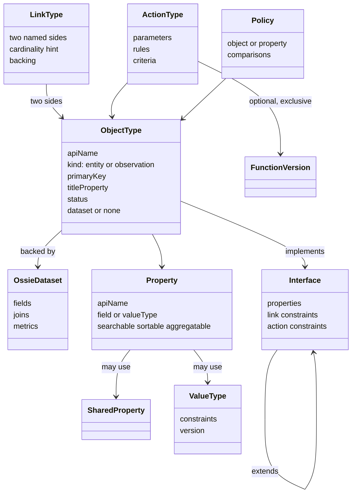
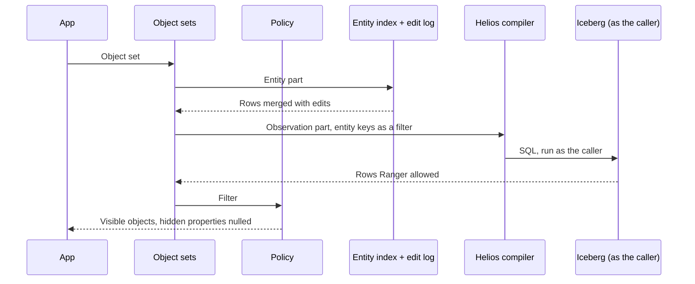
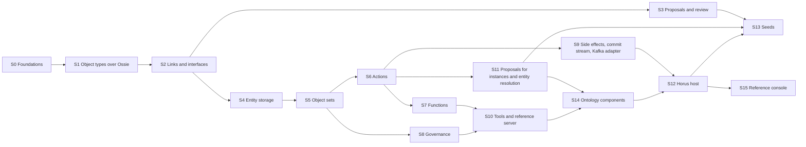

# Helios ontology plan: semantic models plus an operational ontology

Helios is where users create semantic models and ontologies of their own data, for any domain, and where applications and agents read and change that data through them. This plan adds the ontology. It merges two ideas into one stack:

- **Helios**, which builds reviewed semantic models of a warehouse (datasets, fields, joins, metrics) and answers questions through them, running every query as the person asking.
- **An operational ontology**: object types, links and interfaces that applications and agents read, plus a governed write path (actions and functions) and per-object security.

Helios already answers "what does this data mean, and how is this number computed?" The ontology adds "what things exist, how are they related, and who changed what?" Neither is complete alone. Together, they give every Helios host one model that analysts, applications and LLM agents share. The first host is [Horus](https://github.com/Christopheraburns/horus), an intelligence application over a Cloudera lakehouse; how it uses this plan is in its [docs/ONTOLOGY.md](https://github.com/Christopheraburns/horus/blob/main/docs/ONTOLOGY.md).

Palantir Foundry's Ontology is a **reference** for the operational half: its documentation is precise about edge cases (rule order, what a function sees mid-edit, hidden objects versus nulled properties), and this plan borrows those semantics where they are good. It does not copy Foundry's products, screens or names, and it departs from Foundry wherever the Cloudera platform already does the job: Ranger for access control, Iceberg for history, Kafka and Flink for streams.

The work happens in the Helios repo; each host builds only its own extension and its integration ([Helios or the host](#helios-or-the-host)). This plan moved here from the Horus repo on 2026-11-20; its progress is tracked in [ontology-burndown.md](ontology-burndown.md).

**Domain-neutral by design.** Horus is the first host, not the only one. The same ontology and Helios should serve unrelated projects, for example a car manufacturer managing plants, lines, machines, parts, lots and vehicles. Helios holds the mechanics; everything domain-specific lives in packs and host extensions; identity, location and time are declared in the definition rather than written into code. A manufacturing test pack ([Seeds](#manufacturing-test-pack)) checks this: if modelling a factory needs a change to the core, the core was too Horus-shaped.

Points are relative engineering weight, not calendar time. The plan is 16 sprints and 270 points.

## Contents

- [The layers](#the-layers)
- [Design rules](#design-rules)
- [Two kinds of object: entities and observations](#two-kinds-of-object-entities-and-observations)
- [Definition](#definition)
- [Read path](#read-path)
- [Write path](#write-path)
- [Governance](#governance)
- [Streams](#streams)
- [Proposals, review and entity resolution](#proposals-review-and-entity-resolution)
- [Serving: tools, API and applications](#serving-tools-api-and-applications)
- [Helios or the host](#helios-or-the-host)
- [Seeds](#seeds)
- [Sprints](#sprints)
- [After the core](#after-the-core)
- [What Helios has today](#what-helios-has-today)
- [References](#references)

## The layers

```mermaid
flowchart TB
  subgraph apps [Applications and agents]
    horusui[Host applications: the Horus map, workflows]
    explorer[Helios ontology components: object view, explorer, action form, review]
    agents[LLM agents over MCP]
  end

  subgraph onto [Ontology: operational]
    types[Object types, links, interfaces]
    actions[Actions and functions]
    policies[Object and property policies]
    sets[Object sets]
  end

  subgraph sem [Semantic model: Helios / Ossie]
    datasets[Datasets, fields, joins]
    metrics[Metrics]
    review[Propose, review, publish]
  end

  subgraph phys [Physical]
    iceberg[Iceberg via Trino or Impala]
    stream[Kafka and Flink]
    graph[Memgraph]
    pg[Postgres: definition, edit log, entity index]
  end

  apps --> sets
  apps --> actions
  sets --> policies
  types --> datasets
  sets --> metrics
  datasets --> iceberg
  actions --> pg
  stream --> actions
  stream --> pg
  types --> graph
```

| Layer | Answers | Built from |
|---|---|---|
| Applications and agents | Show, explain, act | Helios's ontology components (object view, explorer, action form, review), composed by each host's applications (in Horus: the map, MCP tools for Mistral, the Prime Agent) |
| Ontology | What things exist, how they relate, who may change or see them | This plan |
| Semantic model | What the data means; how a number is computed | Helios (Ossie format), proposed from the warehouse and reviewed by a person |
| Physical | Where the data is | Iceberg tables, Kafka topics, Postgres, Memgraph |

An object type does not point at a raw table. It points at an Ossie dataset, and its properties bind to Ossie fields. Ossie stays the place where columns get meaning and joins get verified; the ontology adds identity, links, edits and policy on top. Helios's README already says Ossie elements "map to ontology classes"; this plan makes that the architecture.

## Design rules

Later sprints must not break these.

1. **Actions are the only write path** for objects and links. A direct property update is an action with one modify rule, or it does not exist.
2. **Functions propose; actions apply.** A function that edits returns an edit batch. Running it in a test harness writes nothing. The action that names it writes, after its submission criteria pass.
3. **Inside an edit function**, a search or aggregation sees the index from before the batch; a fetch by primary key sees pending edits on that object. A test must fail if someone "fixes" this.
4. **Links change through their backing.** Foreign-key links change by editing the foreign-key property; many-to-many links by create-link and delete-link rules; object-backed links by creating or editing the backing object.
5. **Rules fold into one edit per object, in order.** On one property, the later rule wins. An object cannot be deleted and then written, modified and then created, or created twice in one submission. A function rule cannot sit beside other rules.
6. **Submission criteria are separate from the right to edit the action type.** A failure returns that criterion's message. Avoid `NOT` on group, marking or organisation membership: a scoped token can omit the attribute and the `NOT` would pass.
7. **Object policies hide; property policies null.** The primary key is never covered by a property policy. A non-key property belongs to at most one property policy, and an object policy exists before any property policy.
8. **Helios grants nothing.** Base rows are read as the caller, so the warehouse's own permissions (Ranger) decide. Ontology policies can only narrow what the warehouse allows, never widen it.
9. **Copies are grants.** Iceberg tables keep their Ranger policies wherever they are read. The entity index, a materialization or an export does not carry ontology policies, so each is a separate grant, and bulk export waits until markings exist.
10. **Observations are never copied into the entity index.** They are read where they live, through compiled SQL, and every observation query is bounded in time.
11. **Machines propose; people or criteria decide.** Anything a model, crawler or detection creates (an object type, a link, an identity match, an edit) carries a confidence and its evidence, and lands through review or through an action whose criteria accept it. This is Helios's "propose, don't decide" applied to instances.
12. **Layers only add leaves.** A domain pack imports the core; a customer extension imports a pack; neither redefines what it imports. This is the guarantee Helios's ontology layering already makes.
13. **Notifications render from the state before the edit and send after the commit.** A before-webhook that fails aborts the action; an after-webhook that fails is logged for retry and does not roll back.
14. **Helios code never names a domain.** No vessel, MMSI, VIN or position report appears in Helios code. Domain things live in packs; identity keys, location and time are declared on object types, and the mechanics read the declarations.

## Two kinds of object: entities and observations

This is the main departure from the reference. Foundry indexes every object. Horus writes millions of position reports a day, and a factory writes millions of sensor readings; indexing them would copy the lake into Postgres and lose Iceberg's history and Ranger's policies on the way.

| | Entity | Observation |
|---|---|---|
| Examples (Horus) | Vessel, Aircraft, Organization, Port, Alert, Encounter, Person, Document | Position report, AIS static message, camera frame, weather reading |
| Examples (a car plant) | Plant, Line, Station, Machine, Part, Lot, Vehicle, Supplier, WorkOrder | Sensor reading, torque value, inspection result, machine state change |
| Volume | Thousands to millions | Millions per day |
| Stored | Entity index (Postgres) built from an Ossie dataset, plus the edit log | Only in its Ossie dataset (Iceberg) |
| Edits | Yes, through actions | No. Analysts annotate an observation by creating an entity (a Note, a Flag) linked to it |
| Read by | Index queries, merged with edits | SQL compiled by Helios, run as the caller |
| Required in a query | Nothing | A time bound |
| Links | Any backing | Foreign key to an entity (`positionReport.vessel`) |
| Aggregations | Over the index | Ossie metrics |

An object set can mix the two: "vessels flagged by an analyst, with their position reports in the last six hours" is a search-around from an entity set to an observation type, compiled to one SQL query with the entity keys as a filter.

Metrics bind to object types. `vessel.darkHours` is an Ossie metric over position reports, grouped by the vessel link. A metric can be shown on an object view, used as a filter, or called by an agent, and it is computed the same way everywhere because Helios compiles it.

## Definition

One definition, stored as YAML, versioned and reviewed like an Ossie model.



### Object types and properties

An object type has a display name, an API name, a description, a status (`experimental`, `active`, `deprecated`), a kind (`entity` or `observation`), one primary key and a title property. It is backed by one Ossie dataset, or by nothing when every object is created by an action.

A property binds to an Ossie field, or to nothing on an unbacked type. It has a base type or a value type, and the flags applications need: searchable, sortable, aggregatable. Shared properties (`displayName`, `firstSeen`, `confidence`) are defined once and used on many types; the metadata is shared, the values are not. Value types wrap a base type with constraints (regex, range, length, enum) and are versioned.

Base types the core honours:

| Base type | Primary key | Title | Notes |
|---|---|---|---|
| String, integer, short | Yes | Yes | Preferred primary keys |
| Date, timestamp | Discouraged | Yes | Prefer string keys |
| Boolean, byte, long | Discouraged | Yes | Long is awkward in JavaScript above 2^53 |
| Float, double, decimal | No | Yes | |
| Array of an allowed inner type | No | Only if the inner type can be a title | No null elements, no nested arrays |
| Geopoint | No | Yes | `latitude,longitude` |
| Geoshape | No | No | GeoJSON |

Reserved, implemented after the core: vector, struct, media reference, time series as a property, attachment, cipher, marking. (Time-series *observation types* are in the core; see below.)

### Identity keys

An entity type declares how its instances are recognised, so entity resolution and the entity index need no domain code:

| Field | Meaning | Horus example | Car plant example |
|---|---|---|---|
| `scheme` | The kind of identifier, unique per space | `mmsi`, `imo`, `icao24` | `vin`, `partSerial`, `supplierLot` |
| `strength` | `strong`: a match links on its own; `weak`: a match only proposes | MMSI and IMO strong; name weak | VIN and serial strong; supplier name weak |
| `scope` | Where the value is unique | global | per supplier for a lot number |
| `validity` | Whether a value can move to another instance over time | MMSI can be reassigned | serials never move |
| `exclusive` | Whether a value names at most one instance at any moment (default true); two instances claiming it at once is a conflict, not a merge | an MMSI used by two ships at once | one serial printed on two parts |
| `concurrencyWindow` | With `exclusive`: how close in time two claims must be to count as at once. For types that implement `Located`, a claim pair is a conflict only if the implied speed exceeds the type's `maxSpeed` | 10 minutes, with a vessel's 50 knots | a shift, for a part |

**Source trust.** Each source a deployment declares lists the schemes it can vouch for (`vouchesFor`). A strong key claimed by a source that doesn't vouch for that scheme behaves as weak: it proposes and never links. This is provenance (PROV-O: a source is an Agent, a claim an Entity attributed to it), not policy. Example: AIS sends a ship's own MMSI but a crew-typed IMO, so an AIS feed vouches for `mmsi` only; a car plant's end-of-line scanner vouches for `vin`, a dealer's warranty claims for nothing.

Added 2026-11-20 from the Horus evidence ([ontology-identity.md](ontology-identity.md)): `exclusive` and `concurrencyWindow`, because `validity` covers a value moving over time but not two instances using it at once, which AIS shows happening.

The primary key is the entity's own stable id; identity keys are how observations and outside records find it. They are stored in the entity index as identifier rows (entity, scheme, value, valid from and to, source, confidence), which is the crosswalk entity resolution reads and writes.

### Time-series observation types

An observation type can declare itself a series: a series key (for example machine and channel), a sample-time property, value properties with units, and the default downsampling for each value (mean, min, max, last). Object sets over a series accept a time bucket and return the downsampled values, compiled through Helios like any other observation query. Sensor channels are most of a factory's data, so this is core, not an extra; position reports are a series too (keyed by asset).

### Link types

A link type is one relationship with two named sides: `vessel.positionReports` and `positionReport.vessel` are the two sides of one link type, not two link types. Side API names are unique per object type, start with a lowercase letter, and are at most 100 characters. Cardinality (`oneToOne`, `oneToMany`, `manyToOne`, `manyToMany`) is a hint; one-to-one is not enforced.

Backings:

- **Foreign key.** A property on one type holds the other's primary key. Editing the link edits the property. Where Helios has verified the join in the Ossie model, the link reuses it.
- **Join table.** One column per primary key, for many-to-many. The product can create an empty one when links will only come from actions.
- **Object-backed.** An intermediate object type points at both sides through many-to-one links and carries the relationship's own properties (an Affiliation with a role and dates; an identity match with a confidence and a reviewer).

Several link types may connect the same pair, and a type may link to itself.

### Interfaces

An interface is a shape (properties, link constraints, action constraints) with no data and no instances. Object types implement it; an interface can extend several others. A workflow written for `Actor` keeps working when a new type implements `Actor`, which matters in intelligence work, where new kinds of actor keep appearing. Interfaces are real in the definition, in object sets, in actions and in the generated tools.

The core defines only interfaces every domain needs:

| Core interface | Shape | Horus | Car plant |
|---|---|---|---|
| `Actor` | displayName | Person, Organization | Supplier, Operator |
| `Located` | optional `position` (geopoint), optional local position in a named frame, optional `containedIn` link to another `Located` | Vessel by geopoint; Port | Station `containedIn` Line `containedIn` Hall `containedIn` Plant |
| `Occurrence` | a time or an interval | Alert, Encounter | QualityEvent, Downtime |

`Located` does not require latitude and longitude: a factory locates things by containment, often in local coordinates, and a map position is optional. Interfaces specific to a domain (`Evidence` and `Observable` for intelligence work) live in that domain's pack.

### Layers and packs

The definition uses the layering Helios already applies to its LinkML ontology:

```text
core            shared properties, value types, base interfaces (Actor, Located, Occurrence)
packs/osint     Evidence, Observable; Person, Organization, Document, Claim, Source, Affiliation, SameAsAssertion ...
packs/maritime  Vessel, Port, PortCall, Encounter, PositionReport ...
packs/aviation  Aircraft, Airport, Flight ...
packs/manufacturing  Plant, Line, Machine, Part, Lot, Vehicle, WorkOrder ... (test pack)
<host>          a customer's or a demo's own extension
```

Each layer only adds. The core is what Helios code is written against; a pack is what a domain shares; an extension is one deployment's.

### Branches, change sets and publishing

The definition lives in the Helios registry beside Ossie models: a draft branch, change sets that commit on save, an audit record per change (through Helios's `AuditSink`), and immutable published revisions with an activation log, the same mechanism Ossie models use today. Applications read the active revision of main.

Helios's existing LinkML ontology and `OntologyGraph` are stable contracts. They stay, and become a projection generated from the new definition: the graph Memgraph loads, and an OWL or JSON Schema export for anyone who wants one. Deprecation follows Helios's contract policy.

Illustrative fragment:

```yaml
space: horus
ontology: main
imports: [core, packs/maritime]
objectTypes:
  - apiName: vessel
    kind: entity
    displayName: Vessel
    primaryKey: vesselId
    titleProperty: displayName
    implements: [located]
    dataset: { model: horus_lake, dataset: vessels }
    identityKeys:
      - { scheme: mmsi, property: mmsi, strength: strong, validity: reassignable }
      - { scheme: imo, property: imo, strength: strong }
      - { scheme: vesselName, property: displayName, strength: weak }
    properties:
      - { apiName: vesselId, field: vessel_id }
      - { apiName: displayName, sharedProperty: displayName, field: name }
      - { apiName: mmsi, field: mmsi, valueType: mmsi }
      - { apiName: imo, field: imo, valueType: imo }
    metrics:
      - { apiName: darkHours, metric: horus_lake.vessel_dark_hours }
  - apiName: positionReport
    kind: observation
    primaryKey: eventId
    titleProperty: eventId
    dataset: { model: horus_lake, dataset: events_vessel_positions }
    timeProperty: capturedAt
    properties:
      - { apiName: eventId, field: event_id }
      - { apiName: capturedAt, field: captured_at }
      - { apiName: position, field: position, baseType: geopoint }
      - { apiName: vesselId, field: vessel_id }
linkTypes:
  - apiName: vesselPositions
    sides:
      - { objectType: vessel, apiName: positionReports }
      - { objectType: positionReport, apiName: vessel }
    cardinality: oneToMany
    backing: { foreignKey: { on: positionReport, property: vesselId } }
```

## Read path



### Object sets

An object set is a query value, not a loaded list:

```ts
type ObjectSet =
  | { type: "base"; objectType: string }
  | { type: "interface"; interfaceType: string }
  | { type: "filter"; objectSet: ObjectSet; where: Where }
  | { type: "searchAround"; objectSet: ObjectSet; linkSide: string }
  | { type: "timeRange"; objectSet: ObjectSet; from: string; to: string }
  | { type: "traverse"; objectSet: ObjectSet; linkSide: string; depth: number | "all"; asOf?: string }
  | { type: "union" | "intersect" | "subtract"; objectSets: ObjectSet[] };

type Where =
  | { op: "eq" | "neq" | "gt" | "gte" | "lt" | "lte"; property: string; value: unknown }
  | { op: "isNull" | "isNotNull"; property: string }
  | { op: "contains"; property: string; value: string }
  | { op: "arrayContains"; property: string; value: unknown }
  | { op: "withinBBox"; property: string; minLat: number; minLon: number; maxLat: number; maxLon: number }
  | { op: "within"; container: ObjectSet }   // containedIn, followed transitively
  | { op: "and" | "or"; clauses: Where[] }
  | { op: "not"; clause: Where };
```

The same structure exists as Python types; the TypeScript is for the client.

`searchAround` takes one hop. `traverse` follows one link side repeatedly: deep genealogy ("which vehicles contain parts from lot L", through many levels of assembly), ownership chains, containment. `asOf` reads object-backed links whose dates cover that moment, so an as-built genealogy or a past ownership chain can be queried. Traversal runs on the graph view generated from the definition (Memgraph in Horus) or as recursive SQL; `depth: "all"` needs an `asOf` or a cycle-safe link type.

Execution pages, sorts, projects and aggregates. Count, sum, min and max work on any set; anything more is an Ossie metric bound to the type, so the number is defined once. An observation set without a `timeRange` is rejected. Search-around walks whichever backing the link has, across the entity/observation boundary. An interface set is the union of its implementers, with the interface's properties.

### Entity storage

- An indexer loads entity rows from the type's Ossie dataset, through Helios's engine, as a service identity that the host grants explicitly (rule 9). It runs as a batch and also accepts upserts from a stream (see [Streams](#streams)).
- The edit log is stored apart from the base rows. A read merges them: an edit overrides the properties it names; a create with no base row is an object; a delete hides the object.
- The search index updates after the action commits, not inside the function.
- When a dataset is replaced, the change offers two migrations: drop edits, or move them.
- The edit log and the action log are copied to Iceberg on a schedule, so Time Travel covers analyst edits as well as data. An optional materialization writes the latest merged snapshot of a type to Iceberg for downstream jobs.

The entity index has no domain columns: an entity row (type, primary key, properties), the identifier rows from each type's identity keys, and links. The same tables hold vessels and vehicles.

Postgres holds the definition, the edit log and the entity index (btree and trigram search behind an index interface, so a later search engine changes nothing above it). This fits Helios's pluggable-storage decision: the registry and the edit log go through SQLAlchemy; the entity index needs Postgres features, with SQLite and full-text search as the laptop fallback.

## Write path

### Actions

An action type is one transaction: parameters, rules, submission criteria and side effects.

Parameter values come from the caller, from a property of an object parameter, from a static value, from the current user, or from the time the action started (fixed for the whole run; it can differ from the commit time).

Rules: create, modify, create-or-modify, delete; create or delete a many-to-many link; the same against an interface, resolved to the concrete type at submit time; or one function rule, alone. Creating an object can add many-to-many links in the same action. A foreign-key link is set by a modify rule, not a link rule.

Submission criteria are conditions on the current user and the parameters, combined with all, any and none, each root with a failure message. A test run evaluates criteria against sample parameters and writes nothing.

The action log stores the actor, the parameters, the edit batch, the start time and the commit time.

**Machine actors.** A detection job or a crawler submits actions as a named service actor, with criteria written for that actor. An action type can be marked **proposal-only** for machine actors: the submission is stored as a pending proposal, with its confidence and evidence, and an analyst accepts or rejects it (rule 11).

### State machines

An object type can declare a status property with its states and allowed transitions, each bound to an action type. The definition check rejects any other action that writes that property, so a status changes only through a declared transition. Examples: Alert (new, triaged, closed), WorkOrder (released, in progress, complete), Lot (on hold, released, quarantined). Object views show the transitions available from the current state.

### Functions

A published function has a semver version. Query functions return values or object sets. Edit functions return a batch:

```ts
type OntologyEdit =
  | { op: "create"; objectType: string; primaryKey: string; properties: Record<string, unknown> }
  | { op: "update"; objectType: string; primaryKey: string; properties: Record<string, unknown> }
  | { op: "delete"; objectType: string; primaryKey: string }
  | { op: "link"; linkType: string; fromKey: string; toKey: string }
  | { op: "unlink"; linkType: string; fromKey: string; toKey: string };
```

`link` and `unlink` are for many-to-many and join rows; foreign keys are `update`s. The Python helper offers `set_link` and rewrites it for the backing. A function declares which types and link types it edits, and the action checks the batch against that declaration.

Functions are Python, in the same language as Helios and the host. They run in a process the host provides, receive an object-set client, and return the batch as JSON. An action pins a function version; taking later compatible versions automatically is off unless the action owner turns it on, because whoever can publish the function can change what the action does.

### Side effects

Notifications and webhooks, with the timing in rule 13. Every commit is also written to a **commit stream** (see [Streams](#streams)), which is what subscriptions, the map and audit consumers read.

## Governance

Three layers, from the bottom up.

1. **Base rows: the warehouse decides.** Helios runs every observation query, and the indexer's reads, through an engine whose identity mode the host chooses (`token` or `impersonate` for callers). Ranger's row filters and column masks apply, and Ranger audits who read what. Helios's `DataPolicy` refuses a caller's query on a service connection unless the host deliberately allows it.
2. **Ontology policies: narrower, never wider.**
   - Roles on the definition: viewer, editor, owner. Editors change a branch; owners change policies.
   - Object policies hide an object; property policies null properties (rule 7). A policy is a set of comparisons between caller attributes (from Helios's `Caller.attributes`, supplied by the host) and object properties, with a weight limit of 10,000 comparisons so a policy cannot become an unbounded join.
   - **Compiled to Ranger where possible.** A policy that can be expressed on the backing table becomes a Ranger row filter or column mask, generated by the Cloudera plugin, so it also holds in Trino, Spark and Hive. The entity index and the edit log are in Postgres, where Ranger cannot see, so the ontology service enforces policies there itself.
   - A policy test answers "what would this user see on this object?" without saving.
3. **Markings.** A marking property holds marking identifiers, evaluated through one interface. The core ships allow-all. On Cloudera, the evaluator reads Atlas classifications and the markings compile to Ranger tag-based policies; that is Horus burndown 13.4 to 13.6.

What this does not do: carry policies onto copies outside the lake (rule 9), or authenticate anyone. Identity is the host's job.

## Streams

Neither Helios nor the reference has streams; Horus is built on them.

- **Entity upserts.** A stream adapter reads a Kafka topic of entity changes (vessel static data from AIS; a machine or lot record from a factory system) and upserts the entity index, resolving each record through the type's declared identity keys. These are base-row changes, not edits; analyst edits on top survive them under the merge rules.
- **Detections as actions.** Flink results (alerts, encounters) become action submissions by a machine actor: an `Alert` is created, or an identity match is proposed for review. The rules, criteria and log are the same as for a person.
- **Commit stream.** Every committed action is published to a topic. Subscriptions to a saved object set, live map updates and external consumers read it. The action log stays the source of truth; the topic is a feed.
- **Observations need nothing new.** They land in Iceberg through the existing NiFi, Kafka and Flink pipeline and are read in place.

The Kafka adapter lives in Helios, so every host gets the same one; the host supplies topic names, field mappings and its Flink jobs (see the split below).

## Proposals, review and entity resolution

Helios's strength is proposing a model from evidence and having a person review it. The merged plan extends that from schema to instances.

**Proposing the definition.** `helios harvest`, `profile` and `propose` already produce datasets, fields, verified joins and metric candidates, each with a confidence and a rationale. They also propose:

- an object type for a dataset whose key column profiles as an entity identifier;
- a foreign-key link for every verified join between two such datasets;
- the entity/observation kind, from volume and the presence of a timestamp;
- shared properties for fields with the same meaning across datasets.

The reviewer accepts, edits or rejects each one, exactly as for an Ossie model. In the first release this replaces most of a visual definition editor.

**Resolving instances.** The Helios crawler (helios-crawl, deferred to its phase 10) already extracts mentions and claims from documents and resolves entities by tier, recording evidence locations and separating `SameAs` from `PossiblySameAs`. In the merged design:

- crawler output enters the ontology through actions: Document, Mention and Claim objects, with links to the entities they mention;
- a `PossiblySameAs` verdict becomes a SameAsAssertion object, created by a proposal-only action, with its confidence, tier and evidence;
- accepting the assertion runs a merge, which is a function-backed action;
- structured identity uses the same path, driven by declared identity keys rather than per-domain code: a strong key that matches links; a new strong key creates a provisional entity; weak evidence only proposes; two strong keys that disagree are flagged. Horus's cases (an MMSI that changes name, an IMO seen with two MMSIs, an aircraft re-registered) and a factory's (a serial seen on two vehicles, one supplier under three names) are the same mechanism.

## Serving: tools, API and applications

Helios is libraries; hosts serve them. The ontology keeps that split.

- **Tools (Helios, helios-serve).** Plain functions with metadata, added to the existing seven: `describe_object_type`, `search_objects`, `get_object`, `run_object_set`, `aggregate`, `submit_action` (which returns a proposal or a commit), `explain_object` (its sources, edits and lineage). helios-mcp serves them to a local agent; Daedalus or the host serves them to shared deployments. This is how Mistral agents and the Prime Agent reach the ontology.
- **HTTP API (Helios reference server, host sign-in).** Object sets, objects, actions and the definition over HTTP, served by `helios-ontology-server` with the caller taken from the host's sign-in. An OpenAPI description, from which the TypeScript client `@helios/ontology-client` is generated.
- **Ontology components (Helios).** `@helios/ontology-ui`, React components rendered from the definition: an object view (title, visible properties, links, metrics, applicable actions), an object-set table and explorer (search, filter, search-around, saved explorations), an action form (parameters, criteria messages, proposal or commit), a review queue for proposals, an object history (edits, sources, lineage) and a read-only definition browser. The rule: a screen built only from the definition and what the caller may see and do belongs in Helios; a screen that needs domain knowledge or a layout the host chooses belongs in the host. The components are still a library (no server, state or identity: they take a client and a caller), unstyled with theme tokens, and hosts register renderers for property types and link views. React 18 and 19 are peer dependencies, and the components work as Next.js client components (Horus is Next 16, React 19).
- **Reference console (Helios).** A thin shell, bundled with the reference server, that composes the components into an admin and steward UI, so a new host has a usable UI on day one. It follows the Horus host, so the components are proven in a real host first.
- **Applications (host).** Layout, navigation, workflows and domain views. In Horus: the map, with a renderer for `Located` and map popups that open the object view; alert triage. Helios does not build a page or app builder. A visual definition editor waits until after the core; review covers the first release.

## Helios or the host

The rule of thumb is Helios's own: libraries in Helios own the model, the semantics and the mechanics; hosts own identity, serving, deployment and their domain. And a test for anything a host finds missing (decided 2026-11-20): **could a different user run Helios on their own data without taking the same action?** If not, Helios changes, not the host. Gaps found this way are tracked as Track H in [helios-decomposition-burndown.md](helios-decomposition-burndown.md). Horus is the first host, so the table names it where a host's part is meant.

| Piece | Proposed home | Why |
|---|---|---|
| Definition types, validation, YAML format, layering | Helios: helios-cortex | The contract every other piece reads, like the Ossie model |
| Definition store: branches, change sets, revisions, audit | Helios: helios-cortex registry | Same mechanism as Ossie models |
| Entity index, edit log, read merge, materialization | Helios: new helios-ontology | Mechanics, independent of any domain |
| Object sets and their compiler | Helios: helios-ontology, on helios-cortex's compiler | One compiler for metrics and object sets |
| Actions, functions, policies (evaluation) | Helios: helios-ontology | Mechanics; policies evaluated against host-supplied caller attributes |
| Proposals for object types and links | Helios: helios-model | Extends harvest, profile, propose and review |
| Entity resolution and document crawling | Helios: helios-crawl | Already there, deferred |
| Ranger and Atlas compilation, Impala and Trino specifics | Helios: helios-cloudera | Platform plugin, as today |
| Ontology tools | Helios: helios-serve, helios-mcp | Same registry as the existing tools |
| OSINT pack | Helios: packs | Shared by any intelligence host |
| Manufacturing test pack | Helios: packs (tests only) | Proves the core is domain-neutral |
| Reference ontology server: HTTP API over object sets, objects, actions and the definition, with OpenAPI | Helios: `helios-ontology-server`, a reference host outside the libraries (like Daedalus) | Every host needs the same API; decided 2026-11-19 |
| Sign-in and caller attributes | Each host, plugged into the reference server | Helios has no identity by decision |
| Postgres hosting, service deployment | Horus | Host owns deployment |
| Kafka stream adapter | Helios: helios-cloudera or a stream plugin | Any host with streams needs it; decided 2026-11-19 |
| Topic names, mappings, Flink jobs and their wiring to actions | Horus | The host's own pipeline |
| Function runner process | Horus | Host owns processes and sandboxing |
| Ontology components: object view, explorer, action form, review queue, history, definition browser | Helios: `@helios/ontology-ui` (npm), on `@helios/ontology-client` | Built only from the definition, so every host needs the same screens; decided 2026-11-19 |
| Reference console | Helios: bundled with `helios-ontology-server` | A usable UI for a new host on day one |
| Layout, navigation, workflows, map and other domain views | Horus | Applications |
| Maritime and aviation packs, the Horus extension | Horus at first; packs may move to Helios | Domain |

**Boundaries to decide together:**

1. **Is there a reusable server?** *Decided 2026-11-19: yes.* A `helios-ontology-server` reference host, outside the libraries like Daedalus, so a second host (a car manufacturer, say) does not rewrite the API. Hosts plug in sign-in and caller attributes.
2. **Stream adapter.** *Decided 2026-11-19: Helios.* The Kafka adapter lives in helios-cloudera or a new plugin; Horus supplies topic names and mappings.
3. **Postgres as a requirement.** Helios's storage is pluggable. Is the entity index allowed to require Postgres, with SQLite for laptops, or does it need an index plugin interface from day one?
4. **Applications.** *Decided 2026-11-19: generic screens in Helios.* Screens built only from the definition ship as `@helios/ontology-ui` components that Horus embeds; layout and domain views stay with the host (see [Serving](#serving-tools-api-and-applications)).
5. **Domain packs.** Maritime and aviation could be Helios packs for other customers, or stay Horus's.
6. **Helios's release.** The ontology arrives after Helios's general-use release (its phase 9). Does it wait for helios-crawl (phase 10), or does entity resolution start with structured identity only?

## Seeds

Three seeds prove the design. Each is ordinary definition YAML, loaded through review.

### OSINT pack

The first pack, from the reference model.

| Interface | Shared shape | Implemented by |
|---|---|---|
| Actor (core) | displayName, confidence | Person, Organization |
| Located (core) | displayName, position | Location |
| Evidence (this pack) | displayName, url | Document |
| Observable (this pack) | value, confidence, firstSeen, lastSeen | Account, Domain, IpAddress |

Also Event, Claim, Source, Affiliation (object-backed, with role, validFrom, validTo) and SameAsAssertion (object-backed, with confidence, tier, evidence, reviewer). Value types: confidence (0 to 1), url, email, handle, countryCode.

| Link | Backing |
|---|---|
| Person or Organization `locatedAt` Location | Foreign key |
| Event `occurredAt` Location | Foreign key |
| Account `belongsTo` Actor | Foreign key on Account |
| Domain `resolvesTo` IpAddress | Join table |
| Document `mentions` Actor or Event | Join table |
| Claim `attributedTo` Actor; Claim `supportedBy` Document | Foreign key; join table |
| Any seeded object `derivedFrom` Source | Foreign key |
| Affiliation, SameAsAssertion | Object-backed |

Actions: register actor (criteria: collectors group), record affiliation, attach mention, assert claim (at least one document), retract (reason required, kept in the log), and propose identity match (proposal-only for machine actors).

The crawler's existing `EntityRecord`, `MentionRecord`, `ClaimRecord` and `ClaimEvidenceRecord` rows map onto these types; that mapping is the first test of the instance path.

### Horus extension (maritime and aviation)

The first host's own seed: Vessel, Aircraft, Organization, Port, SanctionListing, Alert, Encounter and PositionReport over the Horus lake, with its metrics and actions. It lives in the Horus repo ([docs/ONTOLOGY.md](https://github.com/Christopheraburns/horus/blob/main/docs/ONTOLOGY.md)); its maritime and aviation packs may move here as shared packs once a second maritime or aviation user needs them.

### Manufacturing test pack

A pack for a car plant, kept in Helios as a test with no application and a small synthetic dataset (DuckDB). Its job is to fail loudly if the core assumes intelligence work or a map.

| Object type | Kind | Notes |
|---|---|---|
| Plant, Hall, Line, Station | Entity (implement Located) | Located by `containedIn`, no geopoint below Plant |
| Machine, Tool | Entity | Machine `containedIn` Station |
| Part | Entity | Identity key `partSerial` (strong, never moves) |
| Lot | Entity | Identity key `supplierLot` (strong, scoped per supplier); state machine: on hold, released, quarantined |
| Vehicle | Entity | Identity key `vin` (strong) |
| Supplier | Entity (implements Actor) | Name as a weak key, so three spellings propose one supplier |
| WorkOrder | Entity | State machine: released, in progress, complete |
| QualityEvent | Entity (implements Occurrence) | Raised by people or a detection |
| SensorReading | Observation, series | Series key: machine and channel; values with units |
| Inspection | Observation | Result per part and station |

Links: Part `fromLot` Lot; Lot `suppliedBy` Supplier; Installation (object-backed: part, vehicle or parent part, installed and removed times), which makes the as-built genealogy.

Actions: quarantine lot, release lot, put machine into maintenance (proposal-only when a detection raises it), complete operation.

The pack passes when, with no change to the core, it answers:

1. Which vehicles contain parts from lot L, at any depth of assembly (`traverse` with `asOf`)?
2. Which machines in Hall 2 ran above a temperature limit in the last hour (`within` plus a series bucket)?
3. Quarantine lot L, and show the action log and the state change (state machine).
4. Three supplier spellings become one proposed Supplier (weak identity keys, proposal-only).

## Sprints

Each sprint ends with its outcome working through the library API, covered by tests. Owner is the proposed home and will change as the split is settled.



| Sprint | Owner | Points | Remaining |
|---|---|---:|---:|
| Start |  | 0 | 270 |
| S0 Foundations | Helios | 13 | 257 |
| S1 Object types over Ossie | Helios | 26 | 231 |
| S2 Links and interfaces | Helios | 23 | 208 |
| S3 Proposals and review for the definition | Helios | 13 | 195 |
| S4 Entity storage | Helios | 21 | 174 |
| S5 Object sets | Helios | 25 | 149 |
| S6 Actions | Helios | 24 | 125 |
| S7 Functions | Helios, runner in Horus | 13 | 112 |
| S8 Governance | Helios | 16 | 96 |
| S9 Side effects, commit stream and Kafka adapter | Helios | 11 | 85 |
| S10 Tools and reference server | Helios | 16 | 69 |
| S11 Instance proposals and entity resolution | Helios | 15 | 54 |
| S14 Ontology components | Helios | 21 | 33 |
| S12 Horus host | Horus | 10 | 23 |
| S13 Seeds | Both | 18 | 5 |
| S15 Reference console | Helios | 5 | 0 |

| Layer | Sprints | Points |
|---|---|---:|
| Definition | S0–S3 | 75 |
| Storage and query | S4–S5 | 46 |
| Write path | S6, S7, S9 | 48 |
| Governance | S8 | 16 |
| Serving, resolution, host, seeds | S10–S13 | 59 |
| Ontology components and console | S14, S15 | 26 |

The domain-neutral changes of 2026-11-19 added 25 points: identity keys and series types (S1), `Located` and containment (S2), `traverse` and `within` (S5), state machines (S6), the Kafka adapter moving into Helios (S9, and 2 fewer in S12), the reference server's sign-in interface (S10), resolution driven by identity keys (S11) and the manufacturing test pack (S13). The UI split, also 2026-11-19, added 25 more: the ontology components (S14) and the reference console (S15), with 1 fewer in S12 because Horus embeds the components instead of building its own.

### S0 Foundations (13)

The definition exists and is versioned. Nothing can be queried yet.

| Points | Work |
|---:|---|
| 2 | Stable ids, API names, display names, descriptions, status |
| 3 | Branches and change sets in the Helios registry; published revisions and activation, as for Ossie models |
| 3 | Definition schema, validation and YAML round-trip; registry migrations |
| 2 | Layering: core, packs, extensions; add-only check |
| 1 | Audit records through `AuditSink` |
| 2 | Base type catalog and primary-key and title rules, including reserved types |

### S1 Object types over Ossie (26)

| Points | Work |
|---:|---|
| 5 | Object type with kind, primary key and title, backed by an Ossie dataset |
| 5 | Properties bound to Ossie fields, with search, sort and aggregate flags; checked against the published Ossie revision |
| 2 | Unbacked types for action-created objects |
| 3 | Shared properties |
| 4 | Value types with constraints and versions |
| 2 | Metrics bound to object types from Ossie metrics |
| 3 | Identity keys on entity types: scheme, strength, scope, validity, `exclusive` and `concurrencyWindow`; a value-check hook; `maxSpeed` on `Located` types; stored as identifier rows with status ([ontology-identity.md](ontology-identity.md)) |
| 3 | Time-series observation types: series key, sample time, values with units, default downsampling |

### S2 Links and interfaces (23)

| Points | Work |
|---:|---|
| 3 | Link types with two named sides; side names unique per type |
| 3 | Foreign-key links, reusing verified Ossie joins |
| 3 | Join-table links, including a generated empty table |
| 3 | Object-backed links and their many-to-one prerequisites |
| 1 | Several links per pair; self-links |
| 4 | Interfaces: extends, implements, conformance check |
| 2 | Link and action constraints on interfaces |
| 2 | Core interfaces `Actor`, `Located` (geopoint optional, local frame, `containedIn`) and `Occurrence` |
| 2 | `OntologyGraph` and LinkML generated from the definition (compatibility with Helios's stable contracts) |

### S3 Proposals and review for the definition (13)

| Points | Work |
|---:|---|
| 4 | Propose object types and kinds from harvest and profile |
| 3 | Propose foreign-key links from verified joins; shared properties from matching fields |
| 4 | Review: accept, edit, reject each proposal; publish |
| 2 | Round-trip test: warehouse to published definition with no hand-written YAML |

### S4 Entity storage (21)

| Points | Work |
|---:|---|
| 5 | Indexer from an Ossie dataset through a Helios engine, with an explicit service grant |
| 2 | Upsert interface for stream-fed base rows |
| 5 | Edit log stored apart from base rows |
| 5 | Read merge: overrides, creates, deletes; post-commit index update |
| 2 | Copy of the edit and action logs to Iceberg; optional materialization |
| 2 | Dataset replacement: drop or move edits |

### S5 Object sets (25)

| Points | Work |
|---:|---|
| 4 | Object set structure: base, interface, filter, search-around, time range, set operations |
| 4 | Filters, including geopoint bounding box |
| 5 | Observation sets compiled through the Helios compiler, run as the caller; time bound required |
| 3 | Search-around across all backings and across the entity/observation boundary |
| 3 | Aggregations: count, sum, min, max, grouped; metrics through Ossie |
| 2 | Sort, page, project |
| 3 | `traverse` with depth and `asOf`, on the graph view or recursive SQL |
| 1 | `within` over `containedIn`, transitive |

### S6 Actions (24)

| Points | Work |
|---:|---|
| 3 | Parameters and their five sources |
| 7 | Rules folded to one edit per object, including interface variants and links created with a new object |
| 2 | Illegal combinations rejected; later write wins on one property |
| 4 | Submission criteria, operators and failure messages |
| 2 | Machine actors and proposal-only action types |
| 3 | Transactional apply and the action log |
| 3 | State machines: states and transitions bound to action types; other writes to the status rejected |

### S7 Functions (13)

| Points | Work |
|---:|---|
| 3 | Versioned registry and publish |
| 3 | Query functions over object sets |
| 4 | Edit functions return a batch; a direct run writes nothing; the pre-batch search rule tested |
| 3 | Exclusive function rule, edits declaration checked, version pin; runner interface the host implements |

### S8 Governance (16)

| Points | Work |
|---:|---|
| 3 | Viewer, editor and owner on the definition |
| 5 | Object and property policies with the weight limit, evaluated against `Caller.attributes` |
| 2 | Enforcement inside object sets; primary key excluded; hidden versus nulled |
| 3 | Policies compiled to Ranger row filters and column masks where expressible (helios-cloudera) |
| 2 | Marking hook with an allow-all evaluator |
| 1 | Policy test as a chosen user |

### S9 Side effects, commit stream and Kafka adapter (11)

| Points | Work |
|---:|---|
| 3 | Before and after webhooks with the failure rules |
| 2 | Notifications from pre-edit state, after commit |
| 2 | Commit stream interface; usage counters |
| 1 | Criteria test run that writes nothing |
| 3 | Kafka adapter in Helios: entity upserts through identity keys; commit stream to a topic |

### S10 Tools and reference server (16)

| Points | Work |
|---:|---|
| 6 | Ontology tools in helios-serve; served by helios-mcp |
| 5 | `helios-ontology-server`: HTTP API over object sets, objects, actions and the definition; OpenAPI |
| 3 | Sign-in and caller-attribute interface that each host implements |
| 2 | TypeScript client (`@helios/ontology-client`) generated from the OpenAPI; S14 builds on it |

### S11 Instance proposals and entity resolution (15)

| Points | Work |
|---:|---|
| 4 | Crawler records (entities, mentions, claims, evidence) loaded through actions |
| 4 | SameAsAssertion from `PossiblySameAs`, proposal-only, with evidence |
| 3 | Merge of two entities as a function-backed action |
| 5 | Structured identity from declared identity keys: strong match links, new strong key creates a provisional entity, weak evidence and untrusted sources (`vouchesFor`) propose, exclusive keys claimed at once are contested, conflicting permanent keys are flagged |

### S12 Horus host (10)

The first host's integration: the reference server deployed on Cloudera AI Workbench, Postgres, sign-in, the Kafka adapter wired to its topics, Flink alerts as machine-actor actions, the function runner, and the components embedded in its UI. Tracked in the Horus repo ([docs/ONTOLOGY.md](https://github.com/Christopheraburns/horus/blob/main/docs/ONTOLOGY.md)); listed here because S13 and S15 run after it.

### S13 Seeds (18)

| Points | Work |
|---:|---|
| 5 | OSINT pack: interfaces, types, links, value types, actions; crawler records mapped |
| 6 | Horus extension over the lake and `ref_*` tables, with its metrics and actions (in the Horus repo) |
| 2 | Ask Horus tier 1 reads an object set (Horus burndown 11.4; in the Horus repo) |
| 5 | Manufacturing test pack with its synthetic dataset; the four acceptance questions pass, and its objects render in the S14 components, with no core or component change |

### S14 Ontology components (21)

Generic screens, rendered from the definition. Runs after S10 and S11 and before the Horus host, which embeds them.

| Points | Work |
|---:|---|
| 3 | `@helios/ontology-ui` package: React 18 and 19 peers, Next.js client components, theme tokens, a renderer registry for property types and link views |
| 4 | Object view: title, visible properties, links, metrics, applicable actions; hidden objects and nulled properties shown as policy says |
| 4 | Object-set table and explorer: search, filter, sort, search-around, saved explorations |
| 4 | Action form: parameters from the action, criteria messages, proposal or commit, state-machine transitions |
| 3 | Review queue for definition and instance proposals: accept, edit, reject |
| 2 | Object history and explain (edits, sources, lineage); read-only definition browser |
| 1 | Tests against the S0–S11 fixtures, with two unrelated object types and no domain code |

### S15 Reference console (5)

A usable UI for a new host, after the components are proven in Horus.

| Points | Work |
|---:|---|
| 3 | Console shell: navigation over object types, explorer, review queue, definition browser; the caller from the server's sign-in plug-in |
| 1 | Served as static files by `helios-ontology-server` |
| 1 | Test on the manufacturing test pack with the DuckDB sample |

## After the core

| Increment | Adds | Why it waits |
|---|---|---|
| Visual definition editor | Building types, links and actions in a UI | Proposals and review cover the first release |
| Temporal links | Query any link by a valid interval | `traverse` with `asOf` covers object-backed links; other backings wait |
| Admiralty codes | Reliability and credibility on Claim | A constraint on value types |
| Corroboration | Claim-to-claim support and contradiction | Ordinary links once the seed has been used |
| Markings | A real evaluator and exports that carry the marking | The hook exists; needs Atlas and Ranger tags (Horus burndown 13.4 to 13.6) |
| Scenarios | A branch of object data for what-if | A second data plane; the definition branch is not this |
| Vectors | Vector type and nearest-neighbour on object sets | Search beyond Postgres |
| Saved pages | Pages of object sets, charts and action buttons | The explorer and actions are their runtime |
| Several datasets per type | More than one backing | One is enough for both seeds |
| Rich types | Struct, media reference, time series as a property, cipher | Reserved in the catalog; series observation types cover sensor data in the core |
| Derived properties | A query function registered as a property | Object views can call the function first |
| Video objects | Camera segments as observations, with MISB/KLV footprints | Horus burndown 6.5 to 6.7 and 13.7 |

## What Helios had when the plan was written

Status from the decomposition burndown, 18 Nov 2026: phases 0 to 8 are complete; the general-use release (phase 9) is in progress; helios-crawl (phase 10) is deferred.

| Helios piece | Role in this plan |
|---|---|
| Ossie semantic model: `SemanticModel`, `Dataset`, `Field`, `Relationship`, `Metric` (stable) | The layer object types bind to |
| Compiler (SQLGlot, any dialect) | Compiles observation sets and metrics |
| Engines: DuckDB, SQLAlchemy, Trino; Impala in helios-cloudera; identity modes `service`, `impersonate`, `token` | Reads as the caller |
| `Caller`, `DataPolicy`, `ModelVisibility` (stable) | Identity and the "Helios grants nothing" rule; caller attributes feed policies |
| Registry (SQLAlchemy, Alembic; SQLite or Postgres) and artifact store (immutable revisions, activation log) | Definition store and publishing |
| helios-model: harvest, profile, propose, review, publish | Extended to propose object types and links |
| helios-serve tools and helios-mcp | Extended with ontology tools |
| `AuditSink` | Audit of definition changes and actions |
| LinkML ontology, `OntologyGraph`, `SourceMapping` (stable) | Kept; generated from the new definition |
| Index records: entities, mentions, relationships, claims, evidence | Input to the OSINT pack and entity resolution |
| Crawler and resolver (`SameAs` / `PossiblySameAs`, tiers, evidence) | Entity resolution |

What Helios does not have, and this plan adds: a write path (actions, functions, edit log, state machines), object identity with declared identity keys and an entity index, typed links with backings and deep traversal, interfaces with constraints, object and property policies, streams, and a reference server.

## References

Helios: `README.md`, `packages/helios-cortex/CONTRACTS.md`, `ontology/README.md` and `docs/helios-decomposition-burndown.md`. The first host: Horus's [docs/ONTOLOGY.md](https://github.com/Christopheraburns/horus/blob/main/docs/ONTOLOGY.md), [docs/IDENTITY.md](https://github.com/Christopheraburns/horus/blob/main/docs/IDENTITY.md) (its identity rules and the evidence behind them) and [BURNDOWN.md](https://github.com/Christopheraburns/horus/blob/main/BURNDOWN.md) section 14.

Foundry documentation used as a reference for the operational semantics, read 18 Nov 2026:

- [Ontology overview](https://www.palantir.com/docs/foundry/ontology/overview/)
- [Object types](https://www.palantir.com/docs/foundry/object-link-types/object-types-overview), [properties](https://www.palantir.com/docs/foundry/object-link-types/properties-overview), [base types](https://www.palantir.com/docs/foundry/object-link-types/base-types), [type reference](https://www.palantir.com/docs/foundry/object-link-types/type-reference)
- [Shared properties](https://www.palantir.com/docs/foundry/object-link-types/shared-property-overview), [value types](https://www.palantir.com/docs/foundry/object-link-types/value-types-overview)
- [Link types](https://www.palantir.com/docs/foundry/object-link-types/link-types-overview), [creating a link type](https://www.palantir.com/docs/foundry/object-link-types/create-link-type)
- [Interfaces](https://www.palantir.com/docs/foundry/interfaces/interface-overview)
- [Action types](https://www.palantir.com/docs/foundry/action-types/overview), [rules](https://www.palantir.com/docs/foundry/action-types/rules), [submission criteria](https://www.palantir.com/docs/foundry/action-types/submission-criteria)
- [Functions](https://www.palantir.com/docs/foundry/functions/overview), [Ontology edits](https://www.palantir.com/docs/foundry/functions/edits-overview)
- [Object permissioning](https://www.palantir.com/docs/foundry/object-permissioning/overview), [object and property security policies](https://www.palantir.com/docs/foundry/object-permissioning/object-security-policies)
- [Object sets](https://www.palantir.com/docs/foundry/api/v2/ontologies-v2-resources/ontology-object-sets/ontology-object-set-basics)
